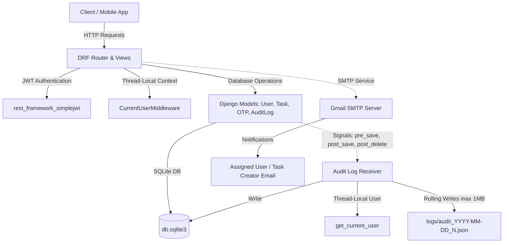
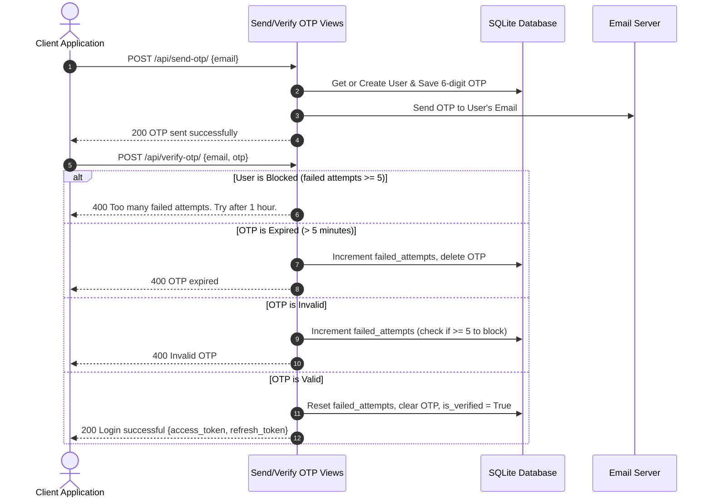
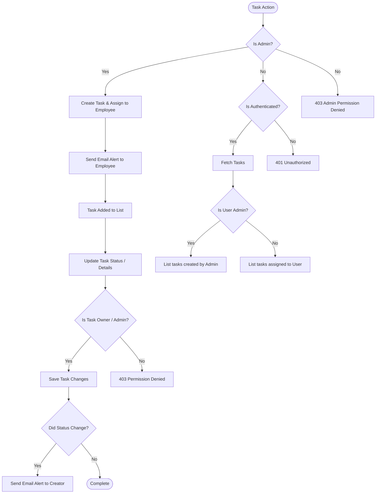
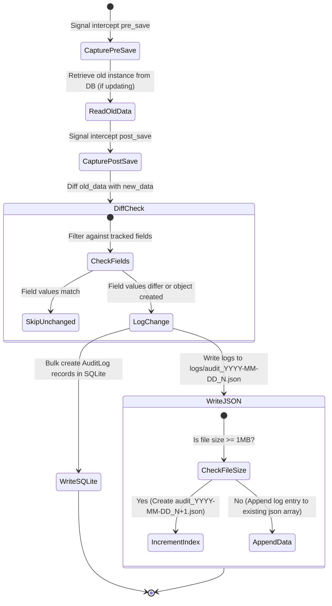

# 🚀 TaskFlow Pro

TaskFlow Pro is a secure, role-based Task Management and Tracking REST API built with **Django** and **Django REST Framework (DRF)**. It implements an OTP-based passwordless login system, robust task creation and assignment workflows, automatic email alerts, and an audit logging mechanism that records activity into both a relational database and rolling JSON files.

---

## 🎨 System Architecture

The project follows a modular Django application structure. Global authenticated user context is preserved thread-locally via a custom middleware, allowing Django database signals to capture audit trail events seamlessly without requiring manual controller injection.



---

## 🔑 Core Features & Workflows

### 1. Passwordless OTP Authentication
Users log in by submitting their email address. An OTP is generated and emailed to them. Upon successful verification of the 6-digit numeric OTP, a JWT token (Access and Refresh) is returned.

*   **Security Lockout:** 5 consecutive failed OTP entry attempts block the user from logging in for **1 hour**.
*   **Expiration:** OTP tokens expire automatically after **5 minutes**.



---

### 2. Task Management & Assignment
Admins can create tasks and assign them to employees (role = `user`). Managers and Admins can update tasks. The assignee or owner gets automatically notified by email upon task assignment and status updates.

*   **Task Filtering:** Tasks can be filtered by `status` (e.g., `pending`, `in_progress`, `completed`).
*   **Task Pagination:** Results are paginated dynamically with a default page size of 5.



---

### 3. Automatic Audit Logging System
TaskFlow Pro logs every write, update, or deletion of tracked models (`Task` and `User`).
*   **Fields Tracked:**
    *   `Task`: `title`, `description`, `status`
    *   `User`: `email`, `username`, `is_verified`, `role`
*   **Storage Targets:**
    1.  **Database Audit Log Table:** Queryable via API by administrative accounts.
    2.  **Local JSON files:** Written into the local `logs/` directory. Each file rolls over to a new indexed file (e.g., `audit_YYYY-MM-DD_1.json`, `audit_YYYY-MM-DD_2.json`) once it hits a **1 MB** file size limit.



---

## 🛠️ Tech Stack
*   **Backend Framework:** Django (v4.2)
*   **API Toolkit:** Django REST Framework (DRF)
*   **Authentication:** DRF SimpleJWT (JSON Web Tokens)
*   **Database:** SQLite (local development)
*   **Email Engine:** SMTP (configured for Gmail)
*   **Filtering:** Django Filters

---

## 📂 Project Structure

```
taskflow_pro/
│
├── accounts/                  # Core API Application
│   ├── migrations/            # Database migration files
│   ├── admin.py               # Django Admin model configurations
│   ├── apps.py                # App Configuration
│   ├── middleware.py          # Thread-local current user middleware
│   ├── models.py              # Models: User, OTP, Task, AuditLog
│   ├── pagination.py          # Custom DRF Pagination configurations
│   ├── permissions.py         # Custom permission classes (Isadmin, IsTaskOwner, etc.)
│   ├── serializers.py         # Serialization rules and validation logic
│   ├── services.py            # Business logic (OTP authentication, task emails)
│   ├── signals.py             # Pre-save/post-save audit trail signals
│   ├── tests.py               # Unit tests
│   ├── urls.py                # Accounts app endpoints routing
│   ├── utils.py               # Helper scripts (OTP generator)
│   └── views.py               # REST API Views
│
├── config/                    # Django Configuration Folder
│   ├── settings.py            # Project configuration (DB, Email, DRF settings)
│   ├── urls.py                # Main URL configurations mapping to /api/
│   ├── wsgi.py / asgi.py      # Server entry points
│
├── logs/                      # Automatically generated rolling JSON audit files
│
├── manage.py                  # Django administrative script
├── .gitignore                 # Files excluded from git tracking
└── README.md                  # Comprehensive project documentation
```

---

## 🔌 API Documentation

All endpoints require authentication (providing the Bearer token in the `Authorization` header), except for the OTP endpoints.

### Authentication

#### 1. Send OTP
*   **URL:** `/api/send-otp/`
*   **Method:** `POST`
*   **Body:**
    ```json
    {
      "email": "admin@gmail.com"
    }
    ```
*   **Response (200 OK):**
    ```json
    {
      "message": "OTP sent successfully"
    }
    ```

#### 2. Verify OTP (Login)
*   **URL:** `/api/verify-otp/`
*   **Method:** `POST`
*   **Body:**
    ```json
    {
      "email": "admin@gmail.com",
      "otp": "123456"
    }
    ```
*   **Response (200 OK):**
    ```json
    {
      "message": "Login successful",
      "access": "eyJhbGciOiJIUzI1NiIsInR5cCI6IkpXVCJ9...",
      "refresh": "eyJhbGciOiJIUzI1NiIsInR5cCI6IkpXVC..."
    }
    ```

---

### Tasks

#### 3. Create Task
*   **URL:** `/api/tasks/create/`
*   **Method:** `POST`
*   **Headers:** `Authorization: Bearer <access_token>`
*   **Permission:** Admins only
*   **Body:**
    ```json
    {
      "title": "Audit Logging Implementation",
      "description": "Ensure signals track model creations and updates in local JSON",
      "status": "pending",
      "assigned_to": 4
    }
    ```
*   **Response (210 Created):**
    ```json
    {
      "id": 1,
      "assigned_to_email": "employee@gmail.com",
      "title": "Audit Logging Implementation",
      "description": "Ensure signals track model creations and updates in local JSON",
      "status": "pending",
      "created_at": "2026-06-22T09:40:00Z",
      "assigned_to": 4,
      "created_by": 1
    }
    ```

#### 4. List Tasks
*   **URL:** `/api/tasks/?status=pending` (status parameter is optional)
*   **Method:** `GET`
*   **Headers:** `Authorization: Bearer <access_token>`
*   **Permission:** Authenticated user (Admins see tasks they created; Employees see tasks assigned to them)
*   **Response (200 OK):**
    ```json
    {
      "count": 1,
      "next": null,
      "previous": null,
      "results": [
        {
          "id": 1,
          "assigned_to_email": "employee@gmail.com",
          "title": "Audit Logging Implementation",
          "description": "Ensure signals track model creations and updates in local JSON",
          "status": "pending",
          "created_at": "2026-06-22T09:40:00Z",
          "assigned_to": 4,
          "created_by": 1
        }
      ]
    }
    ```

#### 5. Update Task
*   **URL:** `/api/tasks/<int:pk>/`
*   **Method:** `PATCH`
*   **Headers:** `Authorization: Bearer <access_token>`
*   **Permission:** Task assignee (Employees) or Admins
*   **Body:**
    ```json
    {
      "status": "completed"
    }
    ```
*   **Response (200 OK):**
    ```json
    {
      "id": 1,
      "assigned_to_email": "employee@gmail.com",
      "title": "Audit Logging Implementation",
      "description": "Ensure signals track model creations and updates in local JSON",
      "status": "completed",
      "created_at": "2026-06-22T09:40:00Z",
      "assigned_to": 4,
      "created_by": 1
    }
    ```

---

### Audit Logs

#### 6. View Database Audit Logs
*   **URL:** `/api/audit-logs/`
*   **Method:** `GET`
*   **Headers:** `Authorization: Bearer <access_token>`
*   **Permission:** Admins only
*   **Response (200 OK):**
    ```json
    [
      {
        "id": 1,
        "user_email": "admin@gmail.com",
        "action": "Task update",
        "action_type": "UPDATE",
        "model_name": "Task",
        "object_id": "1",
        "field_name": "status",
        "old_value": "pending",
        "new_value": "completed",
        "formatted_time": "22-06-2026 03:00 PM"
      }
    ]
    ```

---

## 🚀 Installation & Local Setup

Follow these steps to run TaskFlow Pro locally:

### 1. Prerequisites
Ensure you have Python 3.8+ installed on your machine.

### 2. Clone the Repository
```bash
git clone https://github.com/Zaidbagawan/taskflow_pro.git
cd taskflow_pro
```

### 3. Create a Virtual Environment & Activate It
*   **Windows:**
    ```bash
    python -m venv venv
    venv\Scripts\activate
    ```
*   **macOS / Linux:**
    ```bash
    python -m venv venv
    source venv/bin/activate
    ```

### 4. Install Dependencies
```bash
pip install django djangorestframework djangorestframework-simplejwt django-filter
```

### 5. Configure Email System (Optional)
TaskFlow Pro uses Google SMTP server settings. If you want to send actual emails, verify details in `config/settings.py` or use your credentials. For secure setups, use environment variables:
```python
EMAIL_HOST_USER = os.environ.get('EMAIL_USER')
EMAIL_HOST_PASSWORD = os.environ.get('EMAIL_PASSWORD')
```

### 6. Apply Database Migrations
```bash
python manage.py makemigrations accounts
python manage.py migrate
```

### 7. Run the Development Server
```bash
python manage.py runserver
```
The server will start at `http://127.0.0.1:8000/`. You can import the endpoints into Postman or Insomnia to verify system behavior.

---

## 🔒 License
This project is open-source and available under the MIT License.
